<!-- toggle:start -->

<a href="README.md" title="Français"><picture><source media="(prefers-color-scheme: dark)" srcset="assets/ui/lang-fr-off-dark.svg"></picture></a><a href="#" title="English"><picture><source media="(prefers-color-scheme: dark)" srcset="assets/ui/lang-en-on-dark.svg"></picture></a>&nbsp;&nbsp;&nbsp;<a href="views/en-light.md" title="Light mode"><picture><source media="(prefers-color-scheme: dark)" srcset="assets/ui/theme-sun-off-dark.svg"></picture></a><a href="views/en-dark.md" title="Dark mode"><picture><source media="(prefers-color-scheme: dark)" srcset="assets/ui/theme-moon-on-dark.svg"></picture></a>

<!-- toggle:end -->

<a href="#"><picture><source media="(prefers-color-scheme: dark)" srcset="assets/en/banner-dark.svg"></picture></a>

<a href="#"><picture><source media="(prefers-color-scheme: dark)" srcset="assets/en/title-about-dark.svg"></picture></a>
<a href="#"><picture><source media="(prefers-color-scheme: dark)" srcset="assets/en/about-dark.svg"></picture></a>

<a href="#"><picture><source media="(prefers-color-scheme: dark)" srcset="assets/en/title-projects-dark.svg"></picture></a>

<a href="https://github.com/emna-kaaniche2003/Vortex.git"><picture><source media="(prefers-color-scheme: dark)" srcset="assets/en/card-vortex-dark.svg"></picture></a>
<a href="https://github.com/emna-kaaniche2003/Intelligent-Support-Assistant-using-RAG-LLMs.git"><picture><source media="(prefers-color-scheme: dark)" srcset="assets/en/card-support-dark.svg"></picture></a>
<a href="https://github.com/emna-kaaniche2003/projet_ml_retail.git"><picture><source media="(prefers-color-scheme: dark)" srcset="assets/en/card-retail-dark.svg"></picture></a>
<a href="https://github.com/emna-kaaniche2003/Sign-Language-Recognition-System.git"><picture><source media="(prefers-color-scheme: dark)" srcset="assets/en/card-signlang-dark.svg"></picture></a>

<a href="#"><picture><source media="(prefers-color-scheme: dark)" srcset="assets/en/title-skills-dark.svg"></picture></a>
<a href="#"><picture><source media="(prefers-color-scheme: dark)" srcset="assets/en/skills-dark.svg"></picture></a>

<a href="#"><picture><source media="(prefers-color-scheme: dark)" srcset="assets/en/title-stats-dark.svg"></picture></a>

<a href="#"><picture><source media="(prefers-color-scheme: dark)" srcset="https://github-readme-stats.vercel.app/api?username=emna-kaaniche2003&show_icons=true&bg_color=0D1117&title_color=C4B5FD&icon_color=A78BFA&text_color=F0EBFF&border_color=30363D&card_width=495"></picture></a> <a href="#"><picture><source media="(prefers-color-scheme: dark)" srcset="https://streak-stats.demolab.com/?user=emna-kaaniche2003&background=0D1117&border=30363D&ring=A78BFA&fire=C084FC&currStreakNum=F0EBFF&sideNums=F0EBFF&currStreakLabel=C4B5FD&sideLabels=A8A1C2&dates=A8A1C2&card_width=495&card_height=195"></picture></a>

<a href="#"><picture><source media="(prefers-color-scheme: dark)" srcset="assets/en/title-contact-dark.svg"></picture></a>

<a href="https://www.linkedin.com/in/kaaniche-emna/"><picture><source media="(prefers-color-scheme: dark)" srcset="assets/en/contact-linkedin-dark.svg"></picture></a>
<a href="mailto:emna.kaaniche@enis.tn"><picture><source media="(prefers-color-scheme: dark)" srcset="assets/en/contact-email-dark.svg"></picture></a>
<a href="https://github.com/emna-kaaniche2003"><picture><source media="(prefers-color-scheme: dark)" srcset="assets/en/contact-github-dark.svg"></picture></a>

<a href="#"><picture><source media="(prefers-color-scheme: dark)" srcset="assets/en/footer-dark.svg"></picture></a>
