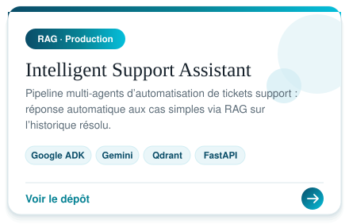
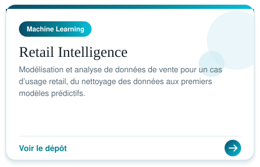
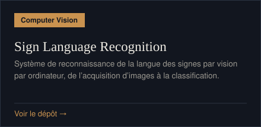
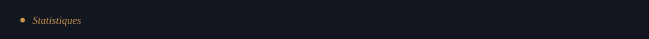

<table>
<tr>
<td width="50%">

</td>
<td width="50%">

</td>
</tr>
<tr>
<td width="50%">

</td>
<td width="50%">

</td>
</tr>
</table>

<table>
<tr>
<td width="50%">

</td>
<td width="50%">

</td>
</tr>
</table>

<table>
<tr>
<td>

</td>
<td>

</td>
<td>

</td>
</tr>
</table>
